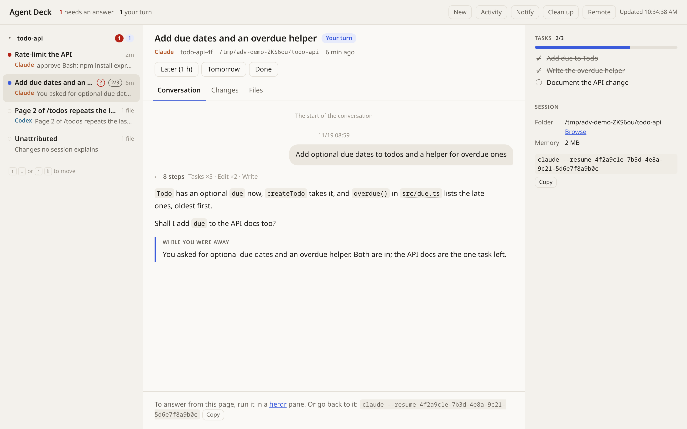
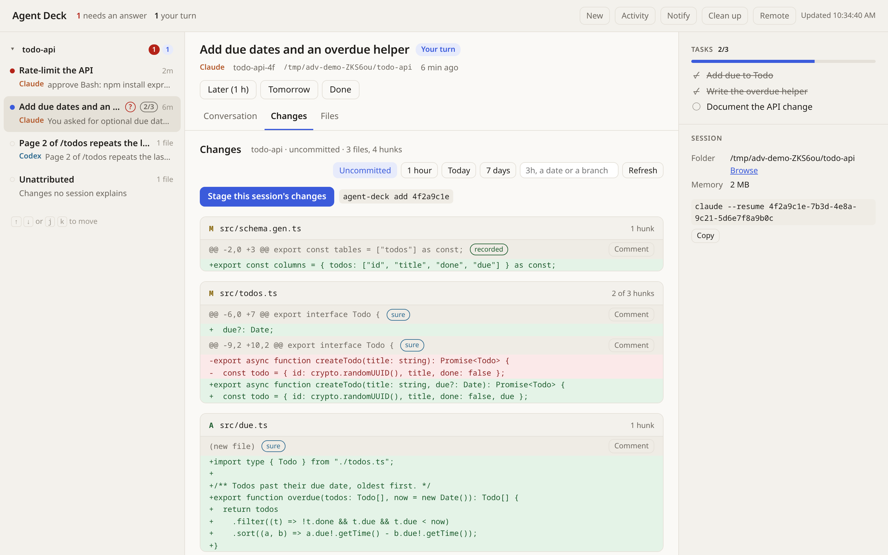
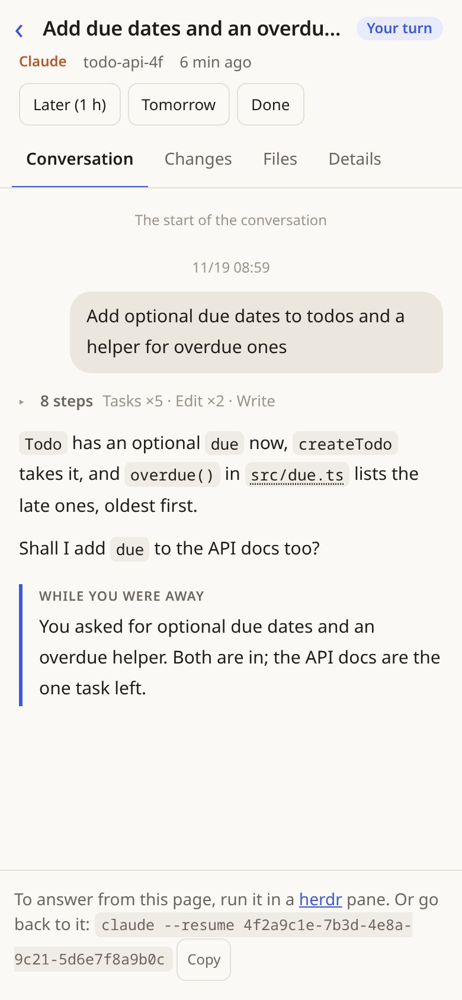

# Agent Deck

Every Claude Code and Codex session you run, on one page, and on your phone. See which sessions
wait on you and for what, what they said, and what they changed. Answer with one tap, get a
notification when one needs you, start new ones, and stage exactly one session's changes.



> Agent Deck used to be AgentDiffViewer (`agent-diff-viewer` on npm). The `agent-diff` commands
> still work: see [Renamed from agent-diff](#renamed-from-agent-diff).

## What it does

- **What waits on you, across every repository.** Every running session, sorted by what it
  needs: an answer (a permission, a question), your turn, working, or idle. You also see its
  title, your last prompt, Claude Code's recap, tasks, background commands, pull requests with
  their CI, context use, and the pages it published.
- **The conversation.** Read back what you and the session said, a page at a time. Markdown is
  rendered, and tool calls fold into one line per run.
- **One tap to answer.** A permission prompt's or a question's choices become buttons, read off
  the session's screen. A working session gets **Stop**, and one waiting for your turn gets
  one-tap replies. You can send files with a prompt, or switch a session's model and effort.
  All of this goes through [herdr](https://herdr.dev).
- **From your phone, signed in with a passkey**, at a host name of yours through a Cloudflare
  Tunnel. To act, the device must have checked its passkey in the last five minutes.
- **Notifications** on your phone or desktop, even with the page closed: when a session asks you
  something, finishes its turn, or its CI fails.
- **New sessions.** Start Claude Code or Codex in a folder, or in a new worktree, with a model,
  an effort level, a first message, and files.
- **Files.** Browse a session's repository, read-only: Markdown, code, and images.
- **Activity.** A timeline of what happened in every session while you were away.
- **CI.** See why a pull request's CI failed, and send that to the session in one tap.
- **Who changed what.** Each uncommitted hunk is attributed to the session that made it, from
  transcripts and optional hooks. You can stage exactly one session's changes.

## Install

You need Node 22.18 or later, and git. Optional:

- [herdr](https://herdr.dev), to answer sessions and start them from the page;
- `gh`, for pull requests and CI;
- `cloudflared`, to use it from your phone.

```bash
npm i -g agent-deck
agent-deck inbox --view           # the page: prints a http://127.0.0.1:… URL to open
agent-deck install                # optional: hooks + a skill for Claude Code and Codex
agent-deck install --statusline   # also: the sessions waiting on you, in Claude Code's status line
```

`install` adds:

- a PreToolUse/PostToolUse hook to `~/.claude/settings.json` and `~/.codex/hooks.json`;
- the `agent-deck-commit` skill to `~/.claude/skills` and `~/.agents/skills`;
- with `--statusline`, Claude Code's `statusLine`, unless you already have one.

It leaves your other hooks alone and keeps a `.bak-agent-deck` backup. In Codex, run `/hooks` once
and trust the hook. `agent-deck uninstall` removes all of it.

## The page

```bash
agent-deck inbox --view          # every running session; start it from anywhere
agent-deck view                  # in a repository: also sessions that ended but left changes here
agent-deck view --since today    # with the changes since a time or a commit
```

| Screen | Layout |
|---|---|
| Desktop (1280 px and wider) | Three columns: the sessions by project, the conversation, and its details |
| Tablet | The sessions and the conversation side by side; the details in their own tab |
| Phone | The list, then one session full screen with Back; the reply box stays at the bottom |

Projects with a session waiting on you come first. Within a project, sessions are sorted by what
they need from you (see [Waiting on you](#waiting-on-you)). Next come the sessions that ended but
left changes in this repository. Idle ones are folded away. Picking a session shows it in tabs:

| Tab | Shows |
|---|---|
| Conversation | What you and the session said, newest at the bottom; scroll up for earlier pages. Tool calls fold into one line per run: open it to see each step. The last run shows its latest step. Recaps, compactions and interruptions appear where they happened. What the session asks, and the reply box, stay at the bottom |
| Changes | The hunks it made in its working tree, each with how sure the attribution is |
| Files | Its repository, read-only: folders, Markdown rendered, code with line numbers, images. Paths in the conversation open here |
| Details | Its tasks, background commands, pull requests (and why CI failed), the pages it published, its context, and how to resume it |

Files stay inside the session's repository (or its own folder, outside one). `.git` is never
shown, and neither are files that commonly hold secrets (`.env`, keys, credentials, `tfstate`).
A session that runs in your home folder shows no files.

The buttons above the changes choose the range:

| Range | Shows |
|---|---|
| Uncommitted (default) | The working tree and the index vs HEAD |
| 1 hour / Today / 7 days, or `3h`, `2026-10-19 09:00` | Everything since the commit that was HEAD then, including later commits. Only sessions active since that time are considered |
| A branch or commit, e.g. `main` | Everything since that commit |

In the uncommitted range, **Stage this session's changes** shows what would be added, then
stages it: whole files the session alone changed, plus only its own hunks of files it shares
with other sessions. **Comment** on any hunk: the comments go to the session as one review
request, or to the clipboard.



On your computer the page listens on 127.0.0.1 only, and every request needs the random token in
the printed URL, so other web pages can't read your sessions. The token stays the same across
restarts, so you can bookmark the URL.

## Waiting on you

```bash
agent-deck inbox                   # in the terminal, from any directory
agent-deck inbox --watch --notify  # a desktop notification when a session starts waiting
```

The inbox lists every running Claude Code and Codex session, in every repository, sorted by what
it needs:

| Section | Means |
|---|---|
| Needs an answer | A permission (`approve Bash: npm test`), an AskUserQuestion (with its options), a plan to approve, a background session blocked on you, or a Codex command that may be waiting for approval |
| Your turn | The session finished its turn: its recap and last reply are shown, marked "?" when the reply ends with a question |
| Working | Running a turn, or waiting for a background command it started |
| Idle for over 1 day | Your turn, but untouched for a day (`--stale 4h` to change it). Folded away |

For each session it also shows, when the transcript says so:

- **its title** (what it works on), **your last prompt**, and the **model** it answers with;
- **"While you were away"**: the recap Claude Code writes after a turn, until you prompt again;
- **its task list** (`3/7`) and the **background commands** still running (and for how long).
  Agents keep a task list on their own only for bigger jobs. To see progress more often, add to
  your `CLAUDE.md`: *"For work with more than two steps, keep a task list (TaskCreate /
  TaskUpdate) and update it as you go."*
- the **pull requests** it opened, with their CI and review state (looked up with `gh`);
- **its context**: tokens in use, against the model's window (Codex) or the point where it last
  compacted (Claude Code), so you see which session will compact soon;
- **shared files**: files another running session also has uncommitted changes in;
- **pages it published**, with the `artifact` tool or CLI of
  [SelfHostArtifacts](https://github.com/Keyhole-Koro/SelfHostArtifacts) or as a claude.ai
  artifact;
- for Codex, how much of the 5-hour and weekly limits is used.

Done with one for now? **Later** takes it off the list for an hour, until tomorrow, or until a
time you give (`--until 9:00`). **Done** takes it off until it does something new. Either way it
comes back by itself as soon as the session moves on.

```bash
agent-deck later 4f2a9c1e --until tomorrow
agent-deck done 4f2a9c1e
agent-deck unhold 4f2a9c1e
```

### Answering from the page (herdr)

When a session runs in a [herdr](https://herdr.dev) pane, the page can act on it, when you click:

- **The choices it asks for, one tap each.** Claude Code's permission prompts and questions,
  Codex's approvals, and plan approval are read off the session's screen as buttons. The keypad
  (`↑`, `Enter`, `Esc`, `y`, `n` …) and the screen itself are folded away underneath. A plan
  waiting for approval is shown in full.
- **A reply**, with files: a photo from the phone, a log, a spec. Files go into
  `.agent-deck/uploads/` in the session's repository; a `.gitignore` inside that folder keeps
  git from seeing them, and the prompt lists their paths.
- **One-tap replies** for a session whose turn it is ("Continue", "Commit your changes" …; in
  Japanese for a Japanese browser). You can change them.
- **Stop** for a working session (`Esc`).
- **Model and effort**: a Claude Code session switches them with its own `/model` and `/effort`.
- **Go to its pane** on this computer.
- **CI**: under a pull request whose CI failed, **Why it failed** shows the end of the failing log
  (`gh run view --log-failed`). One tap sends it to the session, asking it to fix it.

herdr also sees Codex's approval prompts, which Codex itself does not log. Nothing is sent without
a click; `--no-herdr` turns all of this off.

### Starting a session

**New** starts Claude Code or Codex in one of your sessions' folders. It runs in a new herdr tab
in that folder's workspace, or in a new git worktree on a branch you name. You choose the model
and the effort level, write the first message, and attach any files. Claude Code gets its
session id from Agent Deck, so the page opens the new session as soon as it shows up.

### Notifications

**Notify** subscribes this browser to notifications that the page's server pushes: a session
asks you something, finishes its turn, or its CI fails. They come even with the page closed, as
long as the server runs. A tap opens the session.

- **iPhone and iPad** only deliver them to the app added to the home screen. In Safari, tap Share,
  then Add to Home Screen; open Agent Deck from there, and tap **Notify**.
- **Privacy.** The text (the session's name, and what it asks) travels through your browser's
  push service (Apple's, Google's or Mozilla's). It is encrypted so that only your device can read
  it ([RFC 8291](https://www.rfc-editor.org/rfc/rfc8291)), and the server signs its requests with
  its own key ([VAPID](https://www.rfc-editor.org/rfc/rfc8292)).

### Activity

**Activity** is a timeline of every session. While the page's server runs (even with no page
open), it looks every 15 seconds and logs what changed: a session started, asked something,
finished its turn, or ended; it opened a pull request; its CI turned red or green; it published
a page.

### In Claude Code's status line

```bash
agent-deck install --statusline
```

This shows the other sessions waiting on you, under the prompt of the one you are in:
`⏳ 1 needs an answer (Shop checkout: approve Bash: terraform apply) · 2 your turn`. A status line
you already have is left alone; add `agent-deck statusline` to it yourself.

### Before editing a file another session changed

With the hooks installed, Claude Code is warned when it is about to edit a file that another
running session has uncommitted changes in. The warning comes once per new change by the other
session, so Claude keeps their edits and stages only its own.

### Cleaning up

```bash
agent-deck cleanup
```

This lists sessions left idle (with the memory each one holds) and worktrees nobody uses any
more: merged or with their remote branch deleted, clean, and with no session in them. It gives
the commands to close or remove them, but runs none of them. The page has the same under
**Clean up**.

### A snapshot page

```bash
agent-deck inbox --publish            # once
agent-deck inbox --watch --publish    # again on every change, at most every 30 seconds
```

This publishes a snapshot of the inbox to your own
[SelfHostArtifacts](https://github.com/Keyhole-Koro/SelfHostArtifacts) deployment, with its
`artifact` CLI. The result is a private page (only you and the viewers you allow can see it)
that reloads itself every minute.

## From your phone

The page can also be served at a host name of yours, through a
[Cloudflare Tunnel](https://developers.cloudflare.com/cloudflare-one/connections/connect-networks/),
to the devices you added. From the phone you can do everything the page does: read, answer,
start sessions, look at files, get notifications.



```bash
# Once: a tunnel from a host name in your Cloudflare DNS to this computer
cloudflared tunnel login
cloudflared tunnel create agent-deck
cloudflared tunnel route dns agent-deck agents.example.com
cat > ~/.cloudflared/agent-deck.yml <<YML
tunnel: agent-deck
credentials-file: $HOME/.cloudflared/<tunnel id>.json
ingress:
  - hostname: agents.example.com
    service: http://127.0.0.1:47301
  - service: http_status:404
YML
cloudflared tunnel --config ~/.cloudflared/agent-deck.yml run

# The page, also for signed-in devices at that host name
agent-deck inbox --view --remote https://agents.example.com

# Add a phone: scan the QR code, then make a passkey on it
agent-deck remote pair
```

How it is kept to you:

- **Passkeys only.** A device signs in with a passkey made for that host name; there is no
  password. A device is added through a **pairing link** that works once, for 10 minutes, and is
  made on this computer only (`agent-deck remote pair`, or **Remote → Add a phone** on the local
  page). A signed-in device cannot add others, and when one is added, the other devices get a
  notification.
- **Looking is not acting.** Sending prompts or keys, staging, starting a session or sending files
  needs the device's own passkey checked in the last five minutes; the page asks for it.
  Someone who stole a session cookie can look, but not act.
- The session is a signed, `HttpOnly`, `Secure`, `SameSite=Strict` cookie that names its
  passkey. Removing the device (`agent-deck remote revoke`, or **Remote**) ends its sessions and
  its notifications.
- The tunnel's listener is on 127.0.0.1 and answers only requests for the host name. Requests
  that change something must come from the page itself (same origin, and its header). Pages carry
  a strict Content-Security-Policy and cannot be framed.
- Everything a device does (prompts, keys, Later/Done, staging, starting, files, sign-ins) is
  logged: `agent-deck remote log`, or **Remote** on the page.

The keys, the passkeys' public keys, the push subscriptions and the log are in
`$XDG_STATE_HOME/agent-deck/` (`~/.local/state/agent-deck`), readable by you only.

To keep the page and the tunnel running, make them user services. Give node an explicit heap
size. The first look at who changed what reads a month of transcripts, which briefly takes about
a GB of heap; under a memory cap, node would pick a heap too small for that and crash. (The
worker that holds the transcripts lets go of them after ten idle minutes.)

```ini
# ~/.config/systemd/user/agent-deck.service   (ExecStart: the path `which agent-deck` prints)
[Service]
Environment=NODE_OPTIONS=--max-old-space-size=2048
ExecStart=%h/.npm-global/bin/agent-deck inbox --view --port 47300 --remote https://agents.example.com
Restart=on-failure
MemoryMax=3G

[Install]
WantedBy=default.target

# ~/.config/systemd/user/agent-deck-tunnel.service
[Service]
Type=notify
ExecStart=/usr/bin/cloudflared --no-autoupdate tunnel --config %h/.cloudflared/agent-deck.yml run
Restart=on-failure

[Install]
WantedBy=default.target
```

```bash
systemctl --user enable --now agent-deck.service agent-deck-tunnel.service
loginctl enable-linger    # optional: run them while you are logged out too
```

### Where it looks

- **Claude Code** writes a record per running process to `~/.claude/sessions/<pid>.json`,
  including whether it is waiting and for what. It writes one per background session to
  `~/.claude/jobs/<id>/state.json`. These files belong to Claude Code and are undocumented, so a
  new Claude Code version may change them. Transcripts are read incrementally: the first look
  reads the last 2 MB, and later looks only what was appended. The conversation view reads them
  backwards, a page at a time.
- **Codex** holds `~/.codex/thread-writer-locks/<thread>.lock` while a thread is open. Its rollout
  says whether the turn finished, plus the context and the rate limits. Codex does not log
  approval prompts: a command that has run for 30 seconds without output is shown as possibly
  waiting for one, and herdr, when used, tells for sure.
- Holds, the activity log and the remote state are kept in `$XDG_STATE_HOME/agent-deck/`.

## Who changed what, in the terminal

When several Claude Code and Codex sessions work in the same checkout, `git status` mixes their
changes. `agent-deck` tells you which session made each change, down to the hunk. It works from
two sources that fill each other's gaps:

- **Transcripts.** Claude Code (`~/.claude/projects`) and Codex (`~/.codex/sessions`) already log
  every edit. This needs no setup, and covers past sessions too.
- **Hooks** (optional, `agent-deck install`). They record each file's contents before and after
  every tool call, so changes made by shell commands, code generators and scripts are attributed
  exactly.

```text
$ agent-deck
Claude 4f2a9c1e  10/19 19:48–10/19 21:23  Add due dates and an overdue helper
    M src/schema.gen.ts
    M src/todos.ts (2 of 3 hunks; rest by others)
    A src/due.ts

Codex  019a3c5e  10/19 20:48–10/19 20:48  Page 2 of /todos repeats the last item of page 1. Fix it.
    M src/todos.ts (1 of 3 hunks; rest by others)

Not found in any transcript  (edited by hand, by a tool, or by a session older than --days)
    M README.md

$ agent-deck add 4f2a9c1e      # stage that session's files and hunks, nothing else
$ git commit
```

| Command | |
|---|---|
| `agent-deck` | Changes grouped by session (`--by-file`: one line per file) |
| `agent-deck show <session>` | The hunks a session made, as a diff |
| `agent-deck add <session>` | Stage the session's changes (`--dry-run` to preview) |
| `agent-deck view` | The page, in a repository (`--port` to fix the port) |
| `agent-deck inbox` | Running sessions that wait on you, in every repository (`--view`, `--all`, `--stale <time>`, `--watch`, `--notify`, `--publish`) |
| `agent-deck later` / `done` / `unhold` `<session>` | Take a session off the list for a while, or until it moves on |
| `agent-deck cleanup` | Idle sessions and unused worktrees, with the commands to close or remove them |
| `agent-deck statusline` | One line for Claude Code's status line (`install --statusline` sets it up) |
| `agent-deck remote pair` / `devices` / `revoke <id>` / `log` | Add a phone (one-time link and QR code), list or remove devices, see what they did |
| `agent-deck install` / `uninstall` | Hooks and skill for Claude Code and Codex (`--agent claude\|codex` for one) |

| Option | |
|---|---|
| `--since <time>` | `2h`, `1d`, `today` or a date: changes since then, commits included |
| `--base <ref>` | Changes since a branch or commit |
| `--self` | With `show` / `add`: the session running the command (reads `CLAUDE_CODE_SESSION_ID` / `CODEX_THREAD_ID`) |
| `--json` | Machine-readable output |
| `-C <dir>` | Run in another repository |
| `--days <n>` | How far back transcripts are read (default 30) |
| `--remote <origin>`, `--remote-port <n>` | Also serve the page at that origin, through a tunnel to this port (default 47301) |
| `--no-herdr` | Do not use herdr: no answering or starting from the page |

`<session>` is an id prefix, optionally starting with `claude:` or `codex:`.

### Agents committing their own work

With several sessions in one checkout, an agent's `git add -A` sweeps up everyone's half-done
changes. The `agent-deck-commit` skill tells the agent to stage with `agent-deck add --self`
instead, and to check `git diff --cached` before committing.

### How it decides

For each changed file, Agent Deck only considers sessions active after the file's last commit
(or after `--since`). A hunk goes to the session whose writes contain most of its lines:

| Evidence | Confidence |
|---|---|
| The hook recorded the session changing those lines (any tool, shell included) | recorded |
| Edit / Write / MultiEdit calls (Claude), FileChange diffs and apply_patch (Codex) | sure |
| A recorded delete or create of that very file (moves included) | sure |
| Text of a shell command or Codex `exec` script that mentions the file (sed, heredocs, scripts) | likely |
| The same substitution (old → new fragment) that the session made in another file, as a codemod does | likely |
| The only session that touched the file, for a hunk with nothing to match (whitespace) | maybe |

Anything else is unattributed: edits made by hand, by formatters, or by sessions older than
`--days` that the hooks did not see. The hooks keep their records in `.git/agent-diff/` of each
repository; each record is the before and after content of a tool call, stored as git blobs.

## Renamed from agent-diff

- The `agent-diff`, `agent-diff-hook` and `agent-diff-statusline` commands remain, as other names
  for `agent-deck`, `agent-deck-hook` and `agent-deck-statusline`.
- On first start, the state in `~/.local/state/agent-diff` (holds, the page's token, devices)
  moves to `~/.local/state/agent-deck`. The `AGENT_DIFF_*` environment variables are still read.
- `agent-deck install` replaces the hooks, status line and `agent-diff-commit` skill that
  `agent-diff install` set up. The hooks' records stay in `.git/agent-diff/`.
- On npm, the package is now `agent-deck`.

## Development

```bash
npm ci
npm test               # node:test, against temporary repositories and fake transcripts;
                       # the page's tests run in Chromium (npx playwright install chromium)
                       # and are skipped without it. AGENT_DECK_UI_SHOTS=<dir> saves screenshots
npm run typecheck
npm run screenshots    # rebuilds docs/screenshots from a demo repository (Playwright)
```

Releases: bump `version` in package.json and push it to the `publish` branch. GitHub Actions
publishes to npm, with trusted publishing.

## License

MIT
